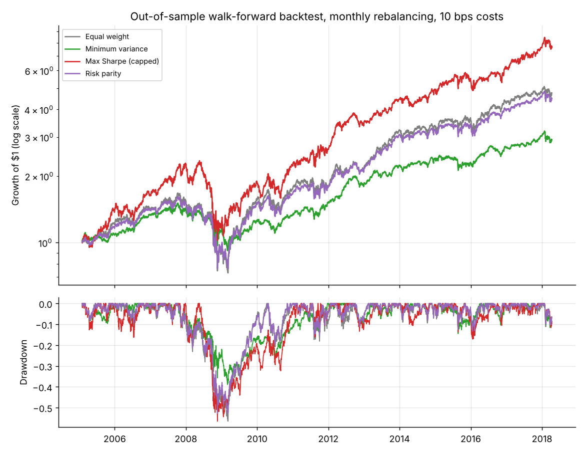
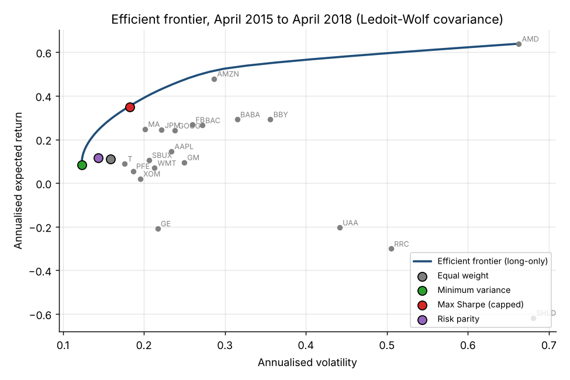
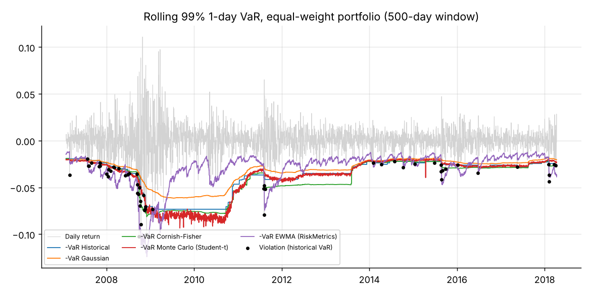

# Portfolio Optimization and Market Risk

This project compares four ways of building a stock portfolio and five ways of measuring its risk
(Value-at-Risk). Everything is tested out of sample on 20 US large caps from 2005 to 2018, a period
that includes the 2008 crisis.



## Objective

1. Do optimized portfolios do better than simply putting the same amount in every stock (1/N)?
2. Do the usual VaR models predict the right number of large losses?

## Method

Four portfolios, rebalanced at the end of each month, long positions only, 0.10% transaction cost:

| Strategy | Rule |
|---|---|
| Equal weight | Same weight for every stock (1/N) |
| Minimum variance | Weights that minimise the portfolio variance |
| Max Sharpe (capped) | Weights that maximise return / volatility, with at most 30% per stock |
| Risk parity | Weights such that each stock contributes the same share of total risk |

The covariance matrix is estimated on the last two years with the Ledoit-Wolf method, which
reduces the noise of the sample covariance. A stock enters the portfolio only once it has two full
years of prices, so no future information is used.

Five VaR models (99%, one day) are computed every day on the last 500 days: historical, Gaussian,
Cornish-Fisher, Monte Carlo with a Student distribution, and EWMA (RiskMetrics). Each model is
checked with the Kupiec test (right number of breaches?) and the Christoffersen test (do breaches
come in clusters?).

## Algorithm

```
FOR each month end d from 2005 to 2018
    history <- daily returns of the 504 days before d
    keep the stocks with a full history
    Cov <- LedoitWolf(history)
    mu  <- average return of each stock x 252
    FOR each strategy
        w <- weights given by the strategy (numerical optimisation)
        turnover <- sum of |w - previous weights|
        cost <- turnover x 0.10%
        during the next month, weights move with prices
        store the daily returns of the portfolio
    END FOR
END FOR

FOR each day t after the first 500 days
    sample <- the 500 previous portfolio returns
    FOR each VaR model
        VaR(t) <- model(sample)
        breach(t) <- (return of day t < -VaR(t))
END FOR
Kupiec test and Christoffersen test on the breaches
```

The code follows these steps with simple loops. Each function in `src/` starts with its algorithm
written as comments.

## Results

### Performance, February 2005 to April 2018

| Strategy | Annual return | Volatility | Sharpe | Max drawdown | Monthly turnover | 99% ES (1 day) |
|---|---|---|---|---|---|---|
| Equal weight | 12.6% | 22.6% | 0.64 | -56.5% | 6% | 5.8% |
| Minimum variance | 8.5% | 16.2% | 0.58 | -38.9% | 9% | 4.2% |
| Max Sharpe (capped) | 16.7% | 24.3% | 0.76 | -56.5% | 32% | 5.9% |
| Risk parity | 12.1% | 20.6% | 0.66 | -52.8% | 6% | 5.4% |

- Minimum variance has 28% less volatility than 1/N and its worst loss is 17 points smaller, but it
  earns less.
- Max Sharpe has the best Sharpe ratio over this period, but it trades five times more than 1/N.
  On average it held 17% in AAPL, 12% in SBUX and 10% in AMZN: it bets on recent winners, which
  worked between 2005 and 2018 but may not work in another period.
- Risk parity gives about the same return as 1/N with less risk and the same turnover.



### VaR backtest, 2,821 days (28 breaches expected)

| Model | Breaches | Rate | Kupiec p-value | Independence p-value |
|---|---|---|---|---|
| Historical | 56 | 1.99% | 0.000 | 0.029 |
| Gaussian | 75 | 2.66% | 0.000 | 0.017 |
| Cornish-Fisher | 41 | 1.45% | 0.023 | 0.023 |
| Monte Carlo (Student-t) | 52 | 1.84% | 0.000 | 0.017 |
| EWMA (RiskMetrics) | 60 | 2.13% | 0.000 | 0.182 |

- All five models have too many breaches. None passes the Kupiec test at the 1% level. The
  Gaussian model is the worst because it ignores fat tails.
- With a fixed 500-day window, breaches come in groups: 32 of the 56 breaches of the historical VaR
  happen in 2007 and 2008.
- EWMA is the only model without clustering (6 breaches in 2008 instead of 24), because it gives more
  weight to recent days. It still has too many breaches because it uses a normal distribution.
- A good 99% VaR therefore needs both a volatility that reacts quickly and fat tails. This is the
  subject of the [GARCH project](https://github.com/KlausKUEKOU/garch-volatility-forecasting).



## Limits

The 20 stocks were chosen in 2018 (survivorship bias), prices exclude dividends and the risk-free
rate is set to zero. These choices favour the strategies that look for return, so the risk results
are the most reliable part.

## Run it

```bash
pip install -r requirements.txt
python run_analysis.py      # about 3 minutes
```

```
data/stock_prices.csv     daily prices of 20 US stocks, 1990 to 2018
src/optimizers.py         Ledoit-Wolf covariance, the four strategies, efficient frontier
src/risk.py               VaR models, Expected Shortfall, Kupiec and Christoffersen tests
run_analysis.py           backtest, VaR backtest, charts
results/                  tables (CSV)
figures/                  charts
```

Data: price file from the open-source [PyPortfolioOpt](https://github.com/robertmartin8/PyPortfolioOpt)
test suite (MIT licence).

Author: Klaus KUEKOU
